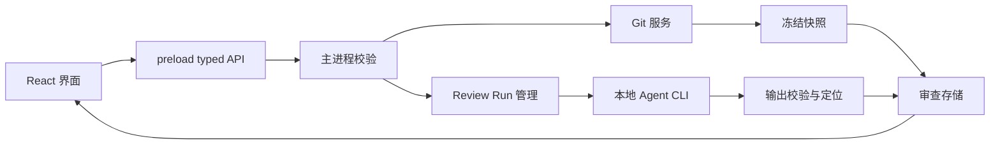

# 架构与工程边界

## 正式目录规划（尚未创建实现）

```text
src/
  main/
    index.ts                  应用生命周期、窗口、退出时停止任务
    ipc/handlers.ts           校验 sender 与输入，调用服务
    services/
      repositories.ts         选择/登记仓库、工作区身份与最近列表
      git.ts                  Git 读取/后续显式写操作
      snapshots.ts            一致性快照、内容指纹、变化检测
      review-store.ts         人工记录与报告的原子持久化
      review-runs.ts          队列、并发、取消、超时与状态机
    agents/
      capabilities.ts         CLI 发现与诊断
      codex.ts                Codex CLI 协议
      claude.ts               Claude Code CLI 协议
      report.ts               schema、报告语义与定位校验
      runner.ts               stdin/stdout、限流、进程树终止
  preload/index.ts            contextBridge typed API
  renderer/
    App.tsx
    features/repositories/    打开仓库、最近仓库、空状态
    features/changes/         文件列表、筛选、Diff/全文
    features/review/          人工状态、反馈、复审
    features/agent-review/    任务、意见、定位、历史报告
    styles/                  原型转译后的 token 和布局
  shared/contracts.ts        纯数据类型，无 Electron/Node/Bun 导入
  shared/schemas.ts          IPC / persisted data / Agent 输出校验
 tests/
  unit/
  integration/               临时 Git 仓库与假 CLI 可执行文件
  e2e/                       Electron 真实桌面流程
```

这是责任划分，不要求机械创建空文件。一个模块有明确输入输出即可；不要把全部逻辑写进 BrowserWindow 或一个千行 React 组件。

## 数据流



前端只提交仓库 ID、snapshot ID、文件 ID、run ID 等不透明标识。主进程解析它们；不接收任意 shell、任意 readFile 或无约束文件路径。系统目录选择结果先由 repositories 服务登记。

## Git 与快照

- 单独记录 git-common-dir 与 git-dir；linked worktree 不串工作区记录。
- 读取使用参数数组，NUL 分隔解析路径，禁用 external diff/textconv；显式处理未初始化 HEAD、冲突、重命名、删除、二进制、符号链接、大文件。
- 第一版差异基线为 HEAD；index 状态另存，内容指纹不依赖文件是否暂存。
- 文件读取、Git patch、HEAD 可能在运行时变化。先后核对 HEAD 与文件内容摘要；不一致则重试或返回 snapshot_changed，不生成 patch/content 不一致的报告输入。
- 冻结内容计算一次，Agent 使用冻结内容，不在同一任务里混用实时文件。
- 正式 Diff 使用可靠的行 diff/parser，不按左右独立列排版；新增文档单栏；大 Diff 虚拟化与资源上限都要显示实际未覆盖范围。

## 存储

初版使用 app.getPath('userData') 下按 repository/worktree ID 分目录的版本化 JSON，原子写入、schemaVersion 与迁移入口。run 逐次保存，不能只留一个 last-result.json。JSON 到 SQLite 是否迁移由实际查询需求决定。

用户仓库、reference/ 和应用安装包不是运行数据目录。草稿定时保存时也要绑定文件与快照，并明确是否已经转成正式问题。

## 进程与 UI

- contextIsolation=true、nodeIntegration=false、sandbox=true。打包页使用本地自定义协议，不加载远程脚本。
- 只暴露枚举明确的 API；IPC 检查请求方与输入 schema。
- 解析 Markdown 不执行 HTML/脚本，处理链接时做协议允许列表。Diff 和 Agent 输出按文本渲染。
- CLI 从主进程受控服务启动；worker 可用 utilityProcess，CLI 本身用 child_process.spawn。不要把工具设置为绕过权限，也不要为了审查更改全局模型配置。
- GUI 启动的 PATH 可能不含 nvm/bun 路径；允许显式选可执行文件并保存路径。诊断要区分 missing / unauthenticated / incompatible / available。
- 单仓库默认一次 Agent run；跨仓库可排队，界面不阻塞。暂停不伪装成取消；退出时先终止自己创建的进程树。

## 不照搬原型的地方

原型 HTTP、硬编码场景文案、全局 DOM 操作、Bun 专用服务、单报告覆盖、部分来源摘录、简单首尾增量比较，都只用于验证交互。正式产品要重写服务边界与状态管理，保留有效的视觉与交互经验。
