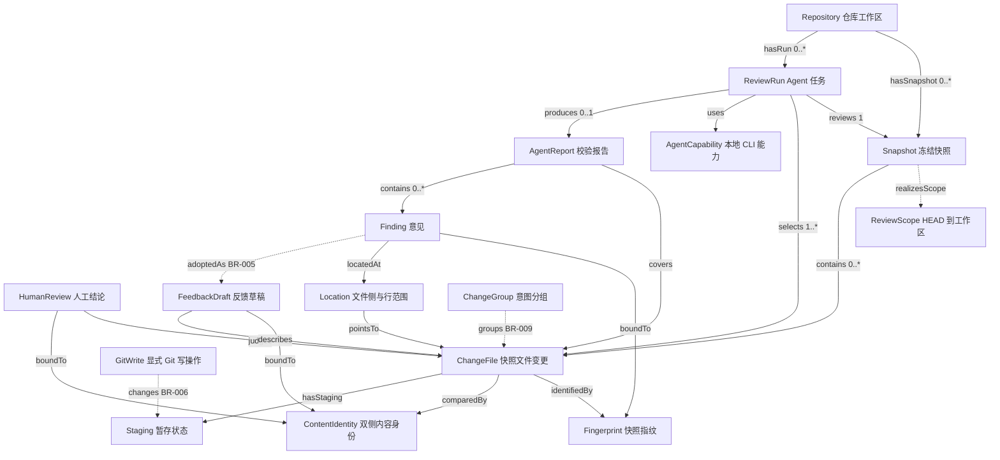
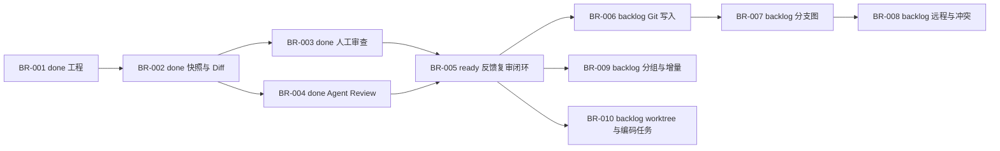

# Branchroom 领域本体与知识图谱

建立日期：2026-10-28。依据项目文档及当前源码静态核对；不是本次重新运行产品验收所得的能力认证。

本图谱回答：项目有哪些对象、对象如何关联、谁有权改变什么状态，以及当前实现覆盖到哪里。采用带证据的属性图；不引入图数据库，不宣称具备 OWL/RDF 形式化推理。机器可读数据见 [graph.json](ontology/graph.json)。

## 建模约定

- 概念层：领域实体、值对象与派生状态；图中概念节点不是用户仓库的实际数据实例。
- 关系层：有方向的谓词，JSON 中的 cardinality 表示一个源对象对应的目标数量，不是反向数量。
- 规则层：跨实体约束，见 JSON 的 constraints。规则是要求，不能据此推断实现已经完整满足。
- 证据层：每个节点、关系、规则都指向仓库内文档或源码；implemented 表示找到实现，specified 表示文档要求或概念抽象，planned 表示后续交付。
- 任务层：BR 编号是实际任务实例，状态使用 BACKLOG 的 done / ready / backlog；与概念的实现状态分开。

## 核心关系图

实线为已有实现；虚线为领域约定或待交付关系。详细状态与证据以 JSON 为准。

## 实体、身份与生命周期

| 概念 | 身份或归属 | 关键语义 | 证据 |
| --- | --- | --- | --- |
| Repository | repoId；根目录区分 worktree | commonGitDir 相同不等于同一审查工作区 | [仓库服务](../src/main/services/repositories.ts) |
| Snapshot | snapshotId，隶属一个 repoId | 冻结 HEAD 与文件内容；不等于 commit；会话登记表在内存中 | [快照服务](../src/main/services/snapshots.ts)、[登记表](../src/main/services/review-service.ts) |
| ChangeFile | 语义键为 snapshotId + fileId；当前 fileId 使用路径 | 同路径在不同快照中是不同内容版本；rename 保存 previousPath | [类型契约](../src/shared/contracts.ts)、[快照服务](../src/main/services/snapshots.ts) |
| Fingerprint | 仓库、HEAD、路径、双侧内容摘要的 hash | Agent 意见绑定该值；stage/unstage 不参与 | [快照服务](../src/main/services/snapshots.ts) |
| ContentIdentity | 双侧内容的 hash | 不含 HEAD；repoId + fileId 的存储分区补充作用域 | [人工审查存储](../src/main/services/review-store.ts) |
| HumanReview | 当前存储槽为 repoId + fileId | reviewed / issue 持久化；pending 无记录；recheck 派生。当前存储不是人工结论的完整版本历史 | [人工审查存储](../src/main/services/review-store.ts) |
| FeedbackDraft | repoId + fileId，另存 snapshotId 和内容身份 | 自动保存草稿不等于保存正式结论；同文件草稿会更新 | [审查服务](../src/main/services/review-service.ts) |
| ReviewRun | runId，绑定 repoId + snapshotId + fileIds | 同快照允许多次 run；历史逐次保存 | [任务管理](../src/main/services/review-runs.ts) |
| AgentReport | 从属一次 run | coverage、limitations、findings；有效报告才有解释价值 | [报告校验](../src/main/agents/report.ts) |
| Finding | 语义键为 runId + finding.id | 当前 id 按路径和序号产生，不能当跨 run 全局 ID | [报告校验](../src/main/agents/report.ts) |
| Location | 文件、base/current、起止行 | 合法范围依附对应内容版本；不能脱离快照解释 | [类型契约](../src/shared/contracts.ts) |
| AgentCapability | provider：codex / claude | CLI 诊断不等于一次运行成功；本地 CLI 仍调用模型服务 | [能力检测](../src/main/agents/capabilities.ts) |

特别区分：HEAD 改变但某文件双侧内容未变时，人工 ContentIdentity 可保持不变；包含 HEAD 的 Fingerprint 会改变。因此不能用一种 hash 替代所有身份规则。

## 状态与不变量

人工审查、Agent 任务、Finding 处置、Git 暂存是四条独立状态轴。Agent 成功、测试通过、已暂存，均不能推出人工已审查。

| 状态轴 | 状态 | 触发与边界 |
| --- | --- | --- |
| 人工审查 | pending / reviewed / issue / recheck | 人保存 reviewed 或 issue；无记录 pending；双侧内容改变派生 recheck；重置清除记录 |
| Agent 任务 | queued / running / succeeded / failed / cancelled / interrupted | 主流程 queued → running → 终态；启动阶段也可能失败或取消；重启把遗留 queued/running 改为 interrupted |
| Finding 处置 | open / accepted / dismissed | 类型已定义；当前适配器只创建 open，采纳与忽略闭环不能据此视为已完成 |
| Finding 时效 | 与当前内容匹配 / stale | 由历史意见与当前内容比较得出，不改写历史报告；直接采纳过期意见的防护属 BR-005 |
| Git 状态 | indexStatus / worktreeStatus | 已能读取；暂存、取消暂存和提交写入属于 BR-006 |

只有任务 succeeded、报告校验通过、覆盖完整且 findings 为空时，才可表述“该次范围内未发现具体问题”；不能解释为所有文件安全。失败、取消、截断、未覆盖与零意见必须分开。issue 是给定材料支持的问题，verify 是需外部证据核对的建议，两者都不自动成为人的结论。

快照前后不一致必须重试或失败；不可审阅文件仍应展示原因。保存人工结论/草稿前核对快照指纹与磁盘内容，过期则拒绝。Agent Review 只读，不能借采纳意见改写用户仓库。规则完整清单见 JSON 的 R1–R9。

## 工程承载

| 领域责任 | 实际模块 | 验证入口（已有文件，本次未重跑） |
| --- | --- | --- |
| 仓库身份、隔离 | [repositories.ts](../src/main/services/repositories.ts) | [repositories.test.ts](../tests/integration/repositories.test.ts) |
| Git 读取、一致快照 | [git.ts](../src/main/services/git.ts)、[snapshots.ts](../src/main/services/snapshots.ts) | [git-snapshot.test.ts](../tests/integration/git-snapshot.test.ts)、[snapshot-integrity.test.ts](../tests/integration/snapshot-integrity.test.ts) |
| 人工结论、草稿与失效 | [review-store.ts](../src/main/services/review-store.ts)、[review-service.ts](../src/main/services/review-service.ts) | [review-flow.test.ts](../tests/integration/review-flow.test.ts) |
| CLI 生命周期与报告 | [review-runs.ts](../src/main/services/review-runs.ts)、[report.ts](../src/main/agents/report.ts)、[runner.ts](../src/main/agents/runner.ts) | [run-manager.test.ts](../tests/integration/run-manager.test.ts)、[agent-report.test.ts](../tests/unit/agent-report.test.ts) |
| 受限 UI 访问 | [IPC](../src/main/ipc/handlers.ts)、[preload](../src/preload/index.ts) | [open-repository.spec.ts](../tests/e2e/open-repository.spec.ts) |

界面经 preload 和 IPC 访问主进程领域服务；不把图中的关系理解成 renderer 拥有文件系统或子进程权限。运行数据存 userData，不放进用户仓库或 reference。

## 交付依赖图

状态来自 [BACKLOG](BACKLOG.md)。不因建立图谱推进任何任务状态。

## 已知证据差异与开放问题

1. AGENTS 的阶段描述仍指向 BR-004；README、BACKLOG、HANDOFF 当前状态段已指向 BR-005。本图按后者及当前源码记录，不改写原有任务历史。
2. CONTRACTS、shared/contracts 部分顶部注释与 HANDOFF 的历史提示词仍描述旧阶段；读取时应优先核对实际类型、实现与 BACKLOG 证据。
3. Location 契约支持 base/current，但 report.ts 当前只校验当前行并生成 side=current；删除文件无法承载当前行意见。不能声称已完整支持 base 定位。
4. AgentReport 契约有 skipped；当前适配器输出 skipped=[]，要求覆盖全部传入文件。RunManager 先过滤不可审阅文件，故“完整覆盖”指 run.fileIds，不代表快照所有文件。
5. 采纳意见为草稿、stale 防护、行内滚动定位、完整反馈复审闭环属于 BR-005。现有 Finding 字段和草稿能力不等于闭环已交付。
6. ChangeGroup、Provenance 目前是领域约定或后续能力，不能当成已有持久化实体。linked worktree 的打开和隔离已存在，自动创建任务 worktree 属 BR-010。

## 使用与维护

可沿关系回答：某意见来自哪个 run、审查哪个快照、定位哪一侧内容；内容变化影响人工结论还是 Agent 意见；某个计划能力依赖哪个任务。查询真实用户记录需要另建运行数据索引，本文件不读取或复制用户仓库与会话数据。

JSON 中 nodes 为概念与任务节点；edges 为有证据的关系；constraints 为文字约束。关系名及方向由各条记录明确声明，未提供通用推理引擎或自动同步。缺少关系表示本图尚未断言，不能推断该关系不存在。

领域类型、身份算法、任务状态或验收发生变化时，同步更新本文与 JSON 的定义、状态和证据，再检查 ID 唯一性、关系端点及所有本地引用。新增证据应保留来源；发现文档与实现冲突应明确记录，不能用规划覆盖实际行为。
