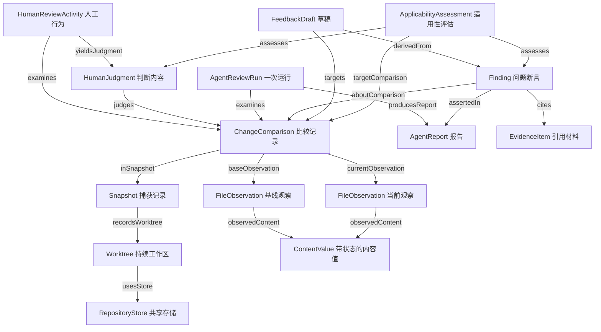

# Branchroom 领域本体草案 v0.2

本体用于明确项目承认哪些事物、它们何以保持身份、相互依赖什么，以及哪些结论允许推出。它不是代码类型清单，也不是给所有名词连线。本文是可检验的领域建模草案；首版三项适用性规则已获用户确认，见 [ADR 0002](adr/0002-review-applicability.md)，其余本体结构仍为建模提案。

配套材料：[本体定义及工程映射](ontology/graph.json)、[合成实例与反例](ontology/examples.json)。本轮重构替代原先将概念、状态和开发任务混放的 v1；JSON 结构升级为 schemaVersion=2，原来的 nodes/edges 不再作为统一表示。

## 建模目的与方法

首先解决审查中的三个问题：用户审查的究竟是哪一份材料；旧判断为什么可以或不可以沿用；Agent 的陈述凭什么成为可信信息。Git 远程操作、团队身份、跨机器仓库同一性暂不建模。

方法参考 Stanford 的 [Ontology Development 101](https://protege.stanford.edu/publications/ontology_development/ontology101-noy-mcguinness.html)：先确定用途与必须回答的问题，再定义类、关系、限制和实例；代码对象结构不能直接代替领域本体。类、实例、对象关系和值属性的区分参考 [W3C OWL 2 Primer](https://www.w3.org/TR/owl-primer/)。本文使用自定义 JSON 表达这些区分，没有宣称遵循 OWL 语法或已完成形式化推理验证。

以下四个基本范畴是本项目采用的工作性区分，不宣称等同于某一通用上层本体：

| 范畴 | 判定依据 | 项目中的例子 |
| --- | --- | --- |
| 持续实体 entity | 有连续身份，可在不同时刻具有不同属性 | 工作区、Git 共享存储、审查主体 |
| 事件 event | 在时间中发生，有参与者、输入及结果 | 某次人工审查、某次 Agent 运行 |
| 信息对象 information | 表达观察、比较、判断、断言或反馈 | 快照、报告、人工判断、意见 |
| 值 value | 按值比较，不主张独立持续身份 | 文本内容、缺席标记；路径、hash、状态等作为值属性 |

类描述某类事物的共同条件，实例是具体的一次发生或一个对象。`AgentReviewRun` 是类，合成的 `run-one` 是实例；“运行成功”是实例的状态值，不是第三种运行实体。

## 本体必须能回答的问题

这些问题先于图谱结构；JSON 的 CQ1–CQ10 对应下表，并指向具体合成案例。

| ID | 问题 | 必须保留的区分 |
| --- | --- | --- |
| CQ1 | 相同 Git 存储下两个 worktree 的同路径同文本，可以共享结论吗？ | 工作区身份与共享存储身份 |
| CQ2 | 仅 stage/unstage 后，旧判断还适用吗？ | 暂存状态与审查材料 |
| CQ3 | 当前文本没变，基线变了，还是同一审查材料吗？ | 当前内容与双侧比较 |
| CQ4 | HEAD 变了、双侧内容没变，人工与 Agent 结果必须同时失效吗？ | 记录身份、内容等价及匹配政策 |
| CQ5 | rename 能否证明文件连续身份并迁移结论？ | 路径映射线索与跨时间同一性 |
| CQ6 | 文件缺席、空文本、内容不可获得是一回事吗？ | 缺席、已知为空与未知 |
| CQ7 | 合法 issue、采纳或测试通过，能证明问题或人工批准吗？ | 断言、证据、处理决定和判断 |
| CQ8 | stale 是意见永久固有的属性吗？ | 相对目标、时间与政策的适用性 |
| CQ9 | 成功且零意见，能推出所有变更无问题吗？ | 固定覆盖范围与普遍结论 |
| CQ10 | 两次运行给出相同文案，是同一条 Finding 吗？ | 命题相同与断言发生相同 |

## 先决定“什么是同一个东西”

**工作区不等于共享 Git 存储。** 两个 linked worktree 可以共用存储，但有各自的 HEAD、index、路径和审查记录。当前代码的 `Repository` 同时携带这两层信息，本体将其区分为 `Worktree` 与 `RepositoryStore`。当前 repoId 按根路径派生；它不能解决目录移动后的身份连续性。

**磁盘文件、文件观察、内容值与变更比较不是同一个对象。** 为避免无依据地承诺“重命名后仍是同一个逻辑文件”，当前本体不建立跨时间的 LogicalFile 身份。它先建立三种可支持的对象：

| 对象 | 指代什么 | 身份或依赖 |
| --- | --- | --- |
| FileObservation | 某快照某侧对某路径的观察 | 依赖 snapshot、side、path；即使文件缺席也可有观察记录 |
| ContentValue | 观察到的文本，或缺席/不可获得状态 | 文本按值比较；不等于文件实体 |
| ChangeComparison | 一对基线和当前观察组成的审查材料记录 | 依赖一个快照及两侧观察；当前记录键可映射为 snapshotId + fileId |

因此，代码的 `ChangeFile` 是观察、双侧内容、比较、Git 状态与派生审查状态的合并表示，不应直接当成本体中一种不可分的文件实体。

**记录相同和内容等价是两个问题。** 两次捕获可生成不同 Snapshot，即使材料相同；两个比较记录不同，不妨碍它们按某种政策被认定可复用审查。相同 hash 也不能单独证明是同一实体，尤其不能跨仓库、工作区或行为发生去合并对象。

**人工审查行为与人工判断不同。** `HumanReviewActivity` 是发生过的行为，`HumanJudgment` 是它表达的判断内容。当前 ReviewEntry 按文件覆写，没有记录完整行为历史，也未记录审查者身份；本体中的区分不意味着产品已持久化这些信息。

**Agent 运行、报告、断言不同。** run 是行为发生，report 是输出记录，finding 是其中一个问题断言。同文案的两条 finding 若来自不同 run，就是两次断言，不因文字相同而合并。两条断言是否指向同一个底层缺陷，需要额外的缺陷身份政策，当前未定义。

## 由这些决定得到关系图

本图展示类之间允许的关系，不表示具体用户数据，也不表示实现先后。定义与实际实例分别放在 JSON 的 ontology 和 examples.json；工程任务另放 engineering。

关系有明确的域、值域和基数。例如，一个 ChangeComparison 必须有一个基线观察和一个当前观察，且两侧属于同一快照；一次运行可以失败而没有有效报告；Finding 必须属于一个报告并指向一个比较。图上的 `assesses` 两条边表示可评估判断或断言，并非每条评估必须同时指向两者。

JSON 的 min/max 是本草案完整实例的校验要求，max=null 表示无上限；并非 OWL 的存在量词语义。类允许继承，如 HumanReviewActivity 是 ReviewActivity；关系域支持父类，不能要求它只接受字面类型完全相同的实例。

## 适用性是有条件的关系

“待复审”不是对历史判断内容的改写。完整表述应是：**在时刻 t，按政策 p，旧判断或断言 x 对目标比较 c 的适用性是 r。**

这给出 `ApplicabilityAssessment(subject, targetComparison, policy, evaluatedAt, result)`。result 可为 applicable、stale、unknown。这里 applicable 仅表示满足所声明的直接复用条件，不能推出问题已证实、风险消失或所有上下文等价。

| 变化 | 人工判断政策 | 当前 Agent 指纹政策 | 理由 |
| --- | --- | --- | --- |
| 只移动暂存位置 | 保留适用性 | 保留适用性 | 双侧内容及定位未变 |
| 基线或当前内容改变 | stale / 待复审 | stale | 审查材料改变 |
| HEAD 改变，双侧内容不变 | 可以保持适用 | stale | 人工摘要不含 HEAD，Agent fingerprint 含 HEAD |
| 只重命名，文本不变 | 当前路径政策不直接复用 | stale | 当前存储与定位依赖路径；没有自动迁移政策 |
| 另一 worktree，同路径同文本 | 不直接复用 | 不直接复用 | 工作区隔离 |
| 有一侧内容未知 | unknown，不自动复用 | unknown，不自动复用 | 未知不能证明相等；这是本体要求，非当前 hash 的既有保证 |
| 先修改，后恢复原材料 | 按声明政策可再次匹配 | HEAD、路径等条件也恢复才匹配 | 适用性相对目标，不是意见永久作废 |

此处保留不同政策，既不宣称 Agent fingerprint 是唯一正确策略，也不为了统一模型而改动生产算法。人工 reviewed/issue 是表达的判断；pending 是没有适用判断的展示状态，recheck 是旧判断与新材料的关系结果。Agent runStatus、Finding disposition、Git indexStatus 则分别描述其他维度。

## 关于“事实”的边界

图谱可以记录“Agent 在 run-one 提出了命题 P”，而不把 P 直接断言成世界中的真事实。

- `issue` 表示提示词要求 Agent 提出由给定材料支持的问题；当前本地校验检查结构、覆盖、合法定位与非空字段，不能验证论证本身成立。
- `verify` 表示需要额外依据核对。缺少依据时保持未知，不能改写为“已经验证的问题”。
- EvidenceItem 是引用材料；是否准确、足够、支持该命题，仍是另一个判断。非空 evidence 字符串不保证证据有效。
- accepted/dismissed 是处理决定；accepted 不等于已修复，dismissed 不等于已证明命题为假。采纳为草稿也不创造人的 reviewed 结论。
- 报告覆盖是固定范围内的覆盖声明，经校验可证明没有漏报输入 ID；不能由此证明 Agent 实际理解了所有内容。成功且零意见也不能证明所有变更正确。

图谱未记录某事实时保持未知。合成示例的必填字段检查只是局部数据完整性验证，不将“缺少事实就是假”推广为全局知识规则。

## 用案例检验，而不是只数节点

[examples.json](ontology/examples.json) 的所有数据均为合成材料；不读取真实仓库、代码或会话。每个实例有 type、值属性和对象关系，场景给出期望答案。

| 场景 | 输入差异 | 预期结果与防止的错误 |
| --- | --- | --- |
| S-worktree | 共用存储、换 worktree | 不共享判断；防止把共享 Git 目录当同一审查空间 |
| S-stage | 只改 index 状态 | 人工与 Agent 匹配仍成立；防止暂存触发无意义复审 |
| S-baseline | 当前文本相同、基线变化 | 两种政策均过期；防止只看新文本 |
| S-head | 双侧文本相同、HEAD 变化 | 人工适用而 Agent 过期；防止混用两种摘要 |
| S-rename | 新路径、旧路径可追溯 | 当前政策不迁移；不声称证明了逻辑文件身份 |
| S-absent-empty | 缺席变成空文本 | 材料不同；防止 null 与空文本折叠 |
| S-unavailable | 同样记录“不可读” | unknown；不能从两个未知推出相等 |
| S-claim | 存在合法断言及派生草稿 | 命题真值仍未知；不自动产生人工批准 |
| S-restored | 内容修改后恢复 | 同一历史断言可对不同目标获得不同适用性 |
| S-coverage | 请求两项，报告只覆盖一项 | 整批覆盖不完整；不能宣称整个请求无问题 |
| S-repeated | 两个 run 给出同文案 | 命题文本相同，Finding 实例不同 |

这些案例检验模型的可表达性与政策一致性，不是应用功能测试，也不替代真实 Electron 验收。

## 与当前实现的映射及发现

以 2026-10-28 本次阅读的源码与 BACKLOG 为依据；本体提案不自动变成生产变更，也不推进任务状态。

| 本体概念 | 当前承载 | 差异与限制 |
| --- | --- | --- |
| Worktree / RepositoryStore | [Repository 与仓库服务](../src/main/services/repositories.ts) | 代码合并表示；root 派生 repoId 不能支持移动连续性 |
| Observation / ContentValue / Comparison | [ChangeFile 类型](../src/shared/contracts.ts)、[快照服务](../src/main/services/snapshots.ts) | null 可表示没有内容或无法读取，需结合其他字段解释 |
| HumanReviewActivity / HumanJudgment | [审查服务](../src/main/services/review-service.ts)、[存储](../src/main/services/review-store.ts) | 没有独立行为记录和完整判断历史；不因本体需要就预建事件溯源系统 |
| AgentRun / Report / Finding | [运行服务](../src/main/services/review-runs.ts)、[报告校验](../src/main/agents/report.ts) | 契约支持 base/current，当前适配器只产生 current 定位；删除文件意见受限 |
| ApplicabilityAssessment | [人工状态派生](../src/main/services/review-store.ts)、[AgentPanel](../src/renderer/features/agent-review/AgentPanel.tsx) | 当前是即时状态/布尔结果，没有独立保存评估时间、政策及 unknown |
| FeedbackDraft / derivedFrom | [采纳操作](../src/renderer/features/agent-review/AgentPanel.tsx)、[草稿存储](../src/main/services/review-store.ts) | 已有定位、采纳和过期拦截；来源嵌入文本，尚无结构化 Finding 来源关系 |

本体分析暴露的两个具体语义缺口：

1. **人工摘要合并了缺席与空文本。** `contentIdentityOf` 使用 `baseContent ?? ''` 和 `currentContent ?? ''`，因此不能区分 absent 与 text(空串)。这是缺少内容状态标记造成的语义折叠，不是 SHA-256 碰撞。模型以 S-absent-empty 明确区分它们；本轮未修改算法或认定所有相关 UI 路径都可复现同一故障。
2. **找不到目标记录不一定等于“仍然适用”。** `listEntries` 找不到最新快照中的路径时回退到已存 identity，可能给出 stale=false；它无法表达“没有目标内容证据”。本体要求对此区分已知匹配、明确不匹配与 unknown。应在独立实现任务中确定干净文件、删除文件、不可读内容各自的处理，不能仅机械地把所有缺失都判 stale。

工程追溯信息独立保留在 JSON 的 engineering：类到实现的映射、实际 BR 任务实例及 dependsOn。当前 BR-005 为 in-progress，定位、草稿采纳、过期拦截和待复审集合机制已存在，仍待三轮真实试用。依据是 [BACKLOG 当前章节](BACKLOG.md)，不能沿用旧图中“BR-005 全部待实现”的判断；README 与部分接手文案仍可能落后。

## 已确认的首版决定

用户已确认 [ADR 0002](adr/0002-review-applicability.md) 的 AP-001–AP-003：只改名仍需审查、不自动迁移结论；文件标记只覆盖自身比较材料，关联影响需明确说明并允许主动复审；仅 HEAD 改变而双侧内容不变时保留人工判断，Agent 意见暂保守标旧。这些规则不意味着完整本体或尚未实现的交互已获验收。

AP-002 是覆盖边界：其他文件变化时，局部标记可保留，但不能据此宣称关联影响已被检查。AP-001 的“需重新审查”不强制要求 UI 使用 recheck；新路径无记录时 pending 也符合该规则。

## 保留为开放决策

- 工作区搬迁后，应继承原身份还是视为新审查空间？当前路径 ID 不能回答。
- 后续若要支持 rename 自动迁移，何种额外依据足以证明可复用？首版已经决定不自动迁移。
- 后续如何识别依赖和配置变化的影响，并触发自动复审？首版已经决定只保证文件自身比较的标记，需明确提示关联影响未覆盖。
- 外部依据能否确认一条 Finding？需要记录谁、何时、用什么验证行为和材料作出确认，不能只新增一个 true 字段。
- 相同问题跨多次 run 的归并、草稿来源追溯、人工判断历史，何时值得独立持久化？由实际产品需求决定，当前本体不强制增加数据库实体。

未解决的身份问题以未知保留；没有把 Git rename 检测、路径相同或 hash 相同升级为普遍的对象同一性公理。

## 维护与验证边界

先修改能力问题及案例，再修改类、关系或政策；实现变化只更新 engineering 映射，除非确实改变了领域含义。每个类声明定义、身份规则、建模依据及项目来源；政策提案不冒充已实现行为。

本轮验证涵盖 JSON 可解析、类/实例分离、继承和关系域值域、必填属性和基数、本地来源路径、案例引用与预期答案。文字约束仍需人工审阅；没有通用 OWL 推理器、运行时用户数据索引或与源码自动同步机制。生产应用未因此变更。
